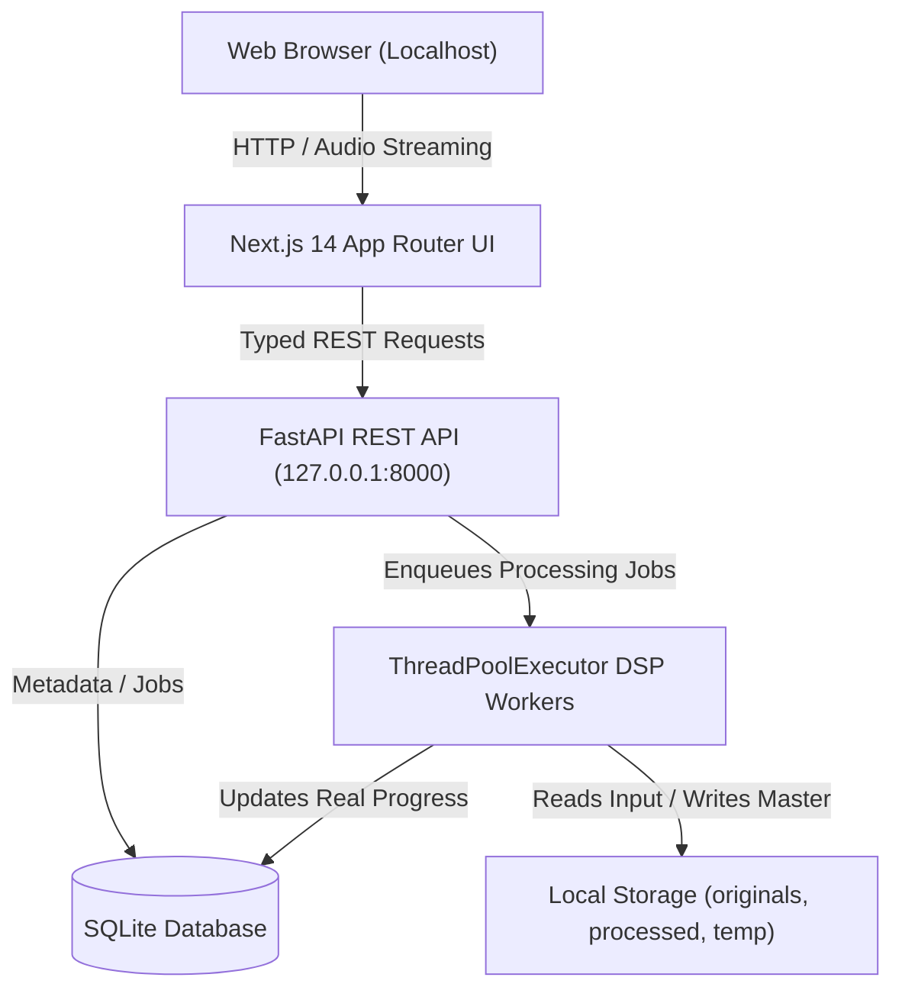

# AI Naat Studio Architecture Document

## Overview

AI Naat Studio is designed as a local-first, low-latency, modular digital audio enhancement workstation. The system adheres to strict separation of concerns, ensuring signal processing integrity, non-blocking asynchronous execution, and complete data privacy.

---

## Subsystem Details

### 1. Frontend Subsystem
- **Framework**: Next.js 14 with React 18, TypeScript, and Tailwind CSS.
- **Waveform Rendering**: WaveSurfer.js v7 canvas rendering engine.
- **State Management**: Reactive React component state coordinating 7 primary workspace views:
  1. **Studio**: Drag & drop uploader, real-time waveform player, progress tracker, and preset quick actions.
  2. **Audio Analysis**: Diagnostic acoustic report, True Peak, LUFS, clipping warnings, and 7-band frequency distribution visualizer.
  3. **Enhancement Settings**: Automatic preset cards (Natural Naat, Studio Naat, Spacious Naat) and advanced fine-tuning sliders.
  4. **Before & After**: Synchronized dual-waveform A/B auditioning, playhead lock, and quality metrics delta comparison table.
  5. **History**: Persistent audit log of all previous audio jobs with download and deletion controls.
  6. **Monitoring**: Live workstation telemetry including CPU utilization %, RAM usage MB, active/failed jobs, audio engine subsystem status, and storage breakdown.
  7. **Settings**: Max file upload limit, master export sample rate, temporary cache retention, and complete session data purge.

### 2. Backend API Subsystem
- **Framework**: FastAPI (Python 3.11).
- **Validation**: Pydantic v2 schemas providing strict type checking and validation.
- **Database**: SQLite with SQLAlchemy 2.0 ORM:
  - `AudioFile`: Metadata for uploaded raw audio recordings.
  - `ProcessingJob`: State machine tracking jobs across 12 distinct execution stages.
  - `AudioOutput`: Mastered audio file references, post-analysis metrics, and quality comparison reports.
- **Security**: Local binding to `127.0.0.1` and strict CORS restricted to the local frontend.

### 3. Background Job Execution Worker
- To prevent CPU-intensive NumPy/SciPy audio signal processing from blocking HTTP request handling, processing jobs are dispatched to a dedicated `ThreadPoolExecutor`.
- Provides real-time stage progress reporting (`decoding`, `analyzing`, `denoising`, `filtering`, `equalizing`, `compressing`, `deessing`, `reverberating`, `normalizing`, `limiting`, `validating`, `exporting`).
- Includes cancellation tokens and automated startup recovery of any interrupted jobs.
